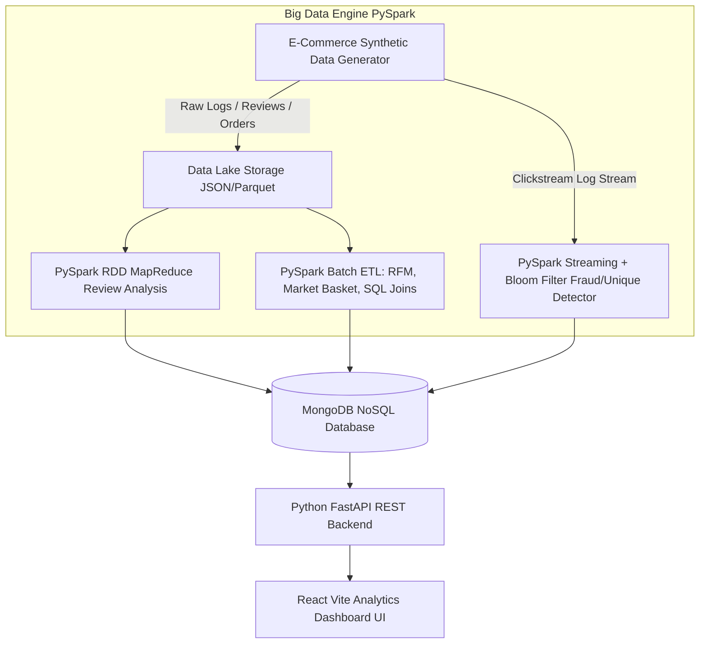

# 🛒 ShopPulse: E-Commerce Big Data & Real-Time Analytics Platform

## 📌 Project Overview
**ShopPulse** is an enterprise-grade Big Data Analytics platform for modern E-Commerce operations. It ingests high-volume clickstream logs, order transactions, customer product reviews, and inventory changes, processes them using **PySpark** and **MongoDB**, and provides real-time & batch analytics via a modern **React UI** dashboard.

---

## 🛠️ Technology Stack
- **Big Data Engine**: PySpark (PySpark SQL, DataFrames, RDD MapReduce, MLlib, Structured Streaming)
- **NoSQL Database**: MongoDB (Mongo Aggregation Pipelines, Document Store, Secondary Indexing)
- **Backend Service**: Python (FastAPI, PyMongo, Uvicorn, Pydantic)
- **Frontend UI**: React (Vite, Tailwind CSS, Lucide Icons, Recharts data visualization)
- **Algorithms & Data Structures**:
  - **Bloom Filter Algorithm**: Real-time stream deduplication & fraud/bot detection
  - **MapReduce (RDD)**: Product review text keyword frequency analysis
  - **RFM Analysis (Recency, Frequency, Monetary)**: Customer segmentation
  - **FP-Growth / Market Basket**: Frequently co-purchased item pairs & association rules
  - **Collaborative Filtering (ALS)**: Product recommendation system

---

## 🎯 Big Data Concepts & Feature Mapping

| Big Data Concept | Project Implementation |
| :--- | :--- |
| **Hadoop Ecosystem & HDFS Operations** | PySpark Parquet & JSON partitioning, HDFS-compatible file layout storage |
| **MapReduce Word Count** | RDD-based MapReduce job on customer product reviews for keyphrase extraction & sentiment term frequency |
| **MongoDB & NoSQL Queries** | Storing analytics outputs, fast indexed lookup for low-latency REST APIs |
| **Hive Query Language (HQL)** | PySpark SQL (`spark.sql`) queries on temp views for complex multi-table analytical joins |
| **Pig Script ETL Data Manipulation** | Declarative PySpark DataFrame transformations (`select`, `filter`, `groupBy`, `window`) |
| **Bloom Filter Data Streaming** | PySpark Streaming pipeline with probabilistic Bloom Filter to filter duplicate clickstreams & bot traffic in real-time |
| **Data Visualization** | Interactive React Dashboard with dynamic charts, real-time KPI streams, and RFM Customer Matrix |
| **Big Data Analytics Technique** | MLlib ALS recommendation engine & FP-Growth Market Basket analysis |

---

## 🏗️ System Architecture



---

## 📂 Project Structure

```
ecommerce-bigdata-analytics/
├── data/                       # Raw datasets (Orders, Clickstreams, Reviews, Products)
├── spark/                      # PySpark processing scripts
│   ├── generator.py            # Synthetic Big Data Generator
│   ├── mapreduce_reviews.py    # RDD MapReduce for Review Keywords
│   ├── batch_etl.py            # PySpark SQL, Pig-style ETL & RFM
│   ├── ml_recommendation.py    # PySpark FP-Growth & ALS Recommendations
│   └── streaming_bloomfilter.py# Real-time Streaming with Bloom Filter
├── db/                         # MongoDB database layer
│   └── mongo_manager.py        # MongoDB connection & aggregation scripts
├── backend/                    # Python REST API
│   ├── app.py                  # FastAPI application entrypoint
│   └── routes.py               # API endpoints serving analytics data
└── frontend/                   # React Frontend (Vite + Tailwind CSS + Recharts)
    ├── src/
    │   ├── components/         # Dashboard KPI cards, RFM Matrix, Stream Ticker
    │   ├── pages/              # Real-Time, Batch, Customer, Product pages
    │   └── App.jsx
    └── package.json
```

---

## 🚀 Execution & Milestone Plan

1. **Phase 1: Foundation & Data Generation**
   - Create synthetic dataset generator producing 50,000+ transaction records, clickstream logs, and reviews.
   - Configure PySpark session & MongoDB schemas.

2. **Phase 2: PySpark Analytics Engine**
   - Implement RDD MapReduce for review analysis.
   - Implement PySpark SQL & DataFrame ETL jobs (RFM, Sales Aggregations, FP-Growth).
   - Implement Bloom Filter probabilistic stream deduplication.

3. **Phase 3: MongoDB Integration & Python FastAPI**
   - Save batch & streaming outputs into indexed MongoDB collections.
   - Build REST API endpoints for all analytics metrics.

4. **Phase 4: Modern React Dashboard UI**
   - Build React + Vite app with interactive visual components.
   - Add live real-time streaming counters, RFM Customer Matrix, and Product Recommendation network graph.
